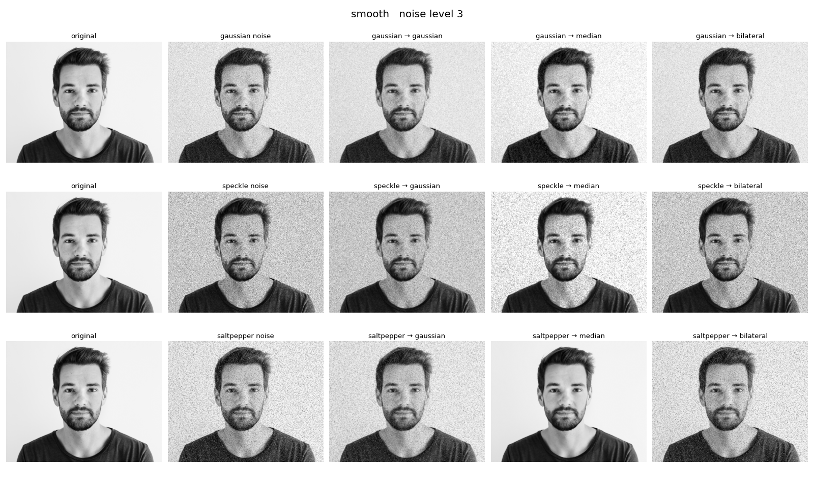
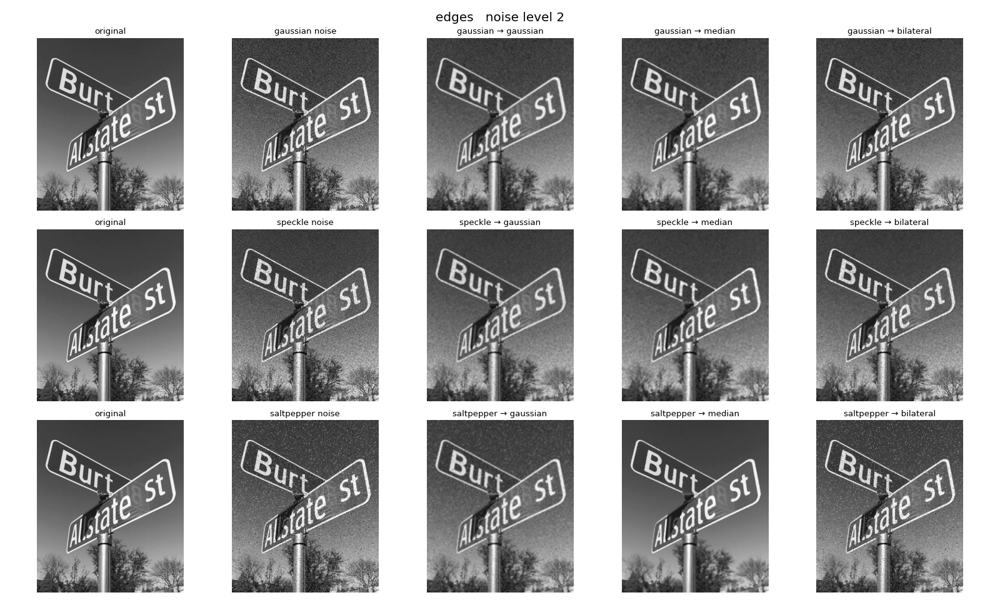

# Module 9: Cleaning Up Noisy Photos on the GPU

Every camera adds some noise to its photos. Low light makes them grainy,
ultrasound and radar images get speckle, and a dead sensor pixel or a bad
transmission leaves random black and white dots. The question I wanted to
answer was simple: which filter should you use for which kind of noise?

To find out, the program takes three real photos, adds three kinds of noise,
cleans each one with three filters and scores how close every result gets to
the original. All of it runs on the GPU using two libraries:

- **cuRAND** (Module 7) generates the random noise.
- **NPP** (Module 8) adds that noise to the photo, runs the filters and
  measures the quality.

## How the two libraries work together

cuRAND writes one random number per pixel straight into GPU memory. NPP then
reads that same buffer and turns it into noise:

| Noise | Real world cause | How it is made |
|---|---|---|
| Gaussian | Grain from low light or sensor heat | cuRAND normal values, added to each pixel with NPP |
| Speckle | Ultrasound, radar, laser images | cuRAND normal values, multiplied by the pixel and added with NPP |
| Salt and pepper | Dead pixels, transmission errors | cuRAND uniform values, turned into a mask with NPP `CompareC`, then written as black or white with NPP `Set` |

The noisy image never leaves the GPU. NPP cleans it with a **Gaussian**,
**median** and **bilateral** filter (all 5x5 so the comparison is fair) and
scores each result against the clean photo with three built in NPP metrics:

- **MAE**: average error per pixel (lower is better)
- **PSNR**: overall error in dB (higher is better)
- **SSIM**: how similar it looks to a person, from 0 to 1 (higher is better)

Each case runs three times with seeds 67, 21 and 16 and the table shows the
mean and standard deviation, so no result depends on one lucky draw. Every
noise and filter step is also timed with CUDA events.

## Build and run

```bash
./build.sh
./run.sh 1     # light noise
./run.sh 2     # medium noise
./run.sh 3     # heavy noise
```

`run.sh` runs every photo in `images/` at the chosen level and saves all the
noisy and cleaned images to `output/`. `assignment_config.yaml` runs all
three levels.

## Results

Run on a Tesla T4 in Google Colab with CUDA 13.0. The full output is in
[results/results.txt](results/results.txt) and side by side images for every
photo and level are in [results/](results/).

**Best filter by PSNR for each case**

| Noise | Level | smooth (portrait) | detailed (crowd) | edges (street sign) |
|---|---|---|---|---|
| Gaussian | light | bilateral | no filter | bilateral |
| Gaussian | medium | gaussian | bilateral | bilateral |
| Gaussian | heavy | median | gaussian | gaussian |
| Speckle | light | bilateral | bilateral | bilateral |
| Speckle | medium | median | gaussian | gaussian |
| Speckle | heavy | median | gaussian | gaussian |
| Salt and pepper | light | median | gaussian | median |
| Salt and pepper | medium | median | gaussian | median |
| Salt and pepper | heavy | median | median | median |

What stood out:

1. **Median is the answer for dead pixels.** On the portrait it takes salt
   and pepper noise from 21.0 dB / SSIM 0.66 to 34.5 dB / SSIM 0.99, which is
   almost the original photo. It barely gets worse as the noise gets heavier.
2. **Bilateral cannot handle dead pixels at all.** It keeps edges sharp by
   ignoring neighbours that look very different, and a pure white dot looks
   very different, so it keeps the dot. Its scores are about the same as the
   noisy image.
3. **Bilateral is the best filter for light grain and the worst for heavy
   grain.** On the street sign it scores 31.5 dB at light noise (Gaussian
   filter: 26.3 dB) but only 17.6 dB at heavy noise (Gaussian filter: 23.5
   dB). Its settings are fixed, and once the noise is stronger than its edge
   threshold it stops smoothing. A real system would tune it to the noise.
4. **Sometimes the best filter is no filter.** On the crowd photo with light
   noise, every filter made the image look less like the original (lower
   SSIM) for all three noise types. A 5x5 blur erases more fine detail than
   the noise does.
5. **Speed.** On the 1024x797 portrait the Gaussian filter takes about
   0.04 ms, median about 0.08 ms and bilateral about 0.11 ms. Making the
   noise takes 0.16 to 0.24 ms. Every filter is fast enough for video, but
   median and bilateral cost two to three times as much as Gaussian.




## Files

| File | What it is |
|---|---|
| `assignment.cu` | The whole program |
| `build.sh` / `run.sh` | Build, and run all photos at one noise level |
| `images/` | The three input photos, converted to grayscale PGM |
| `results/results.txt` | Full output from the Colab run |
| `results/grid_*.png` | Original, noisy and cleaned images for every photo and level |

The photos were downloaded from the web and are used only for this class
assignment.
